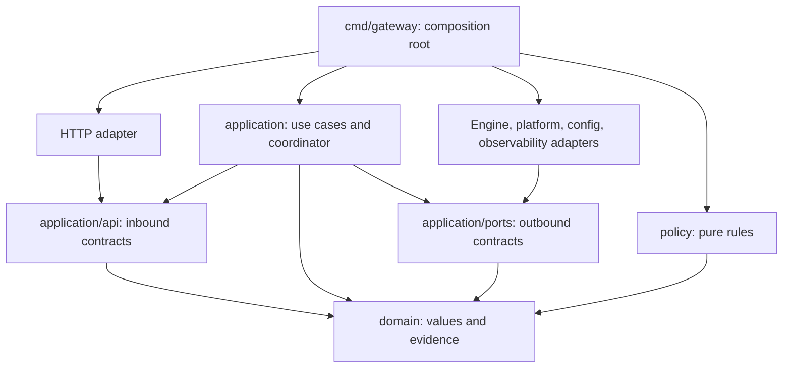

# Architecture: modular monolith and replaceable adapters

Updated 2026-11-09. This document defines module boundaries. Behavioral requirements are in the [initial design](../superpowers/specs/2026-11-08-adaptive-ai-gateway-design.md).

## 1. Scope and status

The coordinator, HTTP adapter, platform sampler, and native engine adapter are implemented. Synthetic-backend and child-process fixtures have passed. Real-model generation remains pending after the host's resource gates prevented loading. See the [runtime report](../reports/2026-11-09-runtime-validation.md) and [implementation plan](../plans/2026-11-08-implementation-plan.md).

One Go control process manages a separate native inference process. The initial deployment uses one local model and one execution slot. Remote workers are a later extension, subject to stable interfaces and a demonstrated requirement. [ADR-0002](../adr/0002-modular-monolith-and-ports.md) records the trade-off.

## 2. Dependency direction

These are compile-time dependencies. The composition root injects use cases into HTTP and outbound adapters into the application. Adapters do not construct the coordinator.

| Package | Responsibility | Excluded concerns |
| --- | --- | --- |
| `internal/domain` | Model and instance identity, observations, semantic output, completion evidence | HTTP/SSE, JSON tags, logging SDKs, syscalls, processes, databases |
| `internal/application/api` | Use cases exposed to inbound adapters | Engine control, sampling, ledger operations |
| `internal/application/ports` | Small outbound interfaces and operation-lifecycle contracts | Engine names, OS constants, provider request bodies |
| `internal/application` | Use cases, coordinator, ledger, request budgets, configuration generations | Raw protocol parsing, process signals, platform probes |
| `internal/policy` | Pure rules that derive resource signals from explicit inputs | Queues, locks, process exit, retries, clock reads |
| `internal/adapter/http` | Authentication, DTOs, errors, SSE, connection backpressure | Capacity grants, engine startup or termination |
| `internal/adapter/llamacpp` | Native protocol, managed process, release evidence | Caller permissions, global resource accounting |
| `internal/adapter/platform` | Periodic sampling and normalization | Admission and interruption decisions |
| `internal/adapter/config` | Configuration and secret sources, validated value conversion | Mutating a running instance |
| `internal/adapter/observability` | Metrics, logs, bounded diagnostic records | Durable business decisions, resource ownership |
| `cmd/gateway` | Constructing and wiring implementations | Scheduling rules |

Domain values, interfaces, and protocol DTOs stay separate. There is no shared `internal/core` package or compile-time dependency between adapters. A new engine or platform connects through its adapter and composition wiring.

Inbound `api` and outbound `ports` are separate packages. HTTP may import domain values and inbound contracts. It cannot import application implementations, outbound ports, or peer adapters. `api.Gateway` exposes generation and scheduler diagnostics; `ResourceAssessmentQuery` exposes resource assessment.

## 3. Control and output paths

The control path is HTTP command -> application coordinator -> outbound work -> completion message with instance identity. Only the coordinator changes capacity grants, queue order, load demand, budgets, and releases. Samplers and engine adapters report observations and evidence.

The output path is engine event -> bounded output channel -> HTTP encoder -> Python caller. `GenerationEvent` carries semantic output. Raw SSE, `http.Response`, process handles, and provider JSON stay in adapters. A slow consumer must not block cancellation, pressure handling, or exit processing.

Blocking loads, generation, exit confirmation, and syscalls run in bounded outbound work outside the command loop. Each operation carries an `InstanceRef` or `ExecutionRef`. The coordinator checks the incarnation before applying a late result. See [runtime contracts](runtime-contracts.md).

## 4. Sampling and diagnostics

`ResourceSampler.Sample` performs periodic collection. `ResourceReader.Read` returns a published snapshot. Diagnostic queries neither trigger OS probes nor change the sampling rate.

`AssessmentService` reads a snapshot, assesses freshness using an explicit clock, and returns a signal. Admission belongs to the coordinator. `ResourceGuard` classifies memory observations; `LoadPolicy` adds attributable external CPU contention. The coordinator applies recovery windows, queuing, grants, and reclamation.

Missing CPU or optional GPU information does not become critical memory pressure. The platform adapter alone may import `C` for the macOS Mach/libproc bridge. The TOML dependency is confined to the configuration adapter.

## 5. Extension points

| Requirement | Extension point | Stable contracts | Required validation |
| --- | --- | --- | --- |
| Another inference backend | Outbound adapter selected at composition | Use cases, ledger, semantic HTTP output | Model identity, context limits, cancellation, release evidence, ambiguous outcomes |
| Linux, NVIDIA, or another platform | Platform sampler | Observations and signal interface | Units, windows, missing values, shared versus separate memory pools |
| Another resource policy | Injected pure rule implementation | Snapshot reader and backend protocol | Required observation guards, high owned load, absence of effects |
| Another client protocol | Inbound adapter | Application commands and evidence | Equivalent cancellation, budgets, and partial-output semantics |
| Durable lifecycle state | Journal port and adapter in the reliable-host stage | HTTP and engine protocols | Crash replay, duplicates, unknown occupancy, ownership recovery |
| Remote workers | RPC adapter and worker execution service | Domain identity and evidence | Authentication, deduplication, fencing, partition-safe capacity |

Use dependency injection and compile-time interfaces. Dynamic plugins, reflection registries, global backend singletons, and generic repositories are outside the initial design. Add narrow interfaces and capability declarations as requirements arise.

`BackendCapabilities` defaults to unsupported. Attached services carry no process-termination authority. Cancellation without confirmed completion leaves occupancy unknown. Each implementation must pass its contracts and hardware checks before a capability is enabled.

Versioned runtime profiles hold validated serving configuration. The adapter maps a profile to GPU layers, threads, and device parameters. Generic commands carry model identity, a profile reference, and neutral context/concurrency constraints. Inconsistent references or constraints are rejected. Parameter changes drain the old instance and create a new incarnation; changing placement during generation requires separate engine support.

## 6. Readiness and capacity

`/healthz` reports control-process liveness. `/readyz` reports whether the initialized application can safely process API commands. Startup, shutdown, and structural faults make it unready. An unloaded model, a busy slot, ordinary queuing, or temporary resource protection does not by itself change service readiness.

`/admin/scheduler` reports `can_execute_now`, `can_queue`, engine state, and protection reasons. Actual generation remains subject to admission checks.

This permits the first request to trigger on-demand loading. A failed Kubernetes readiness probe removes a Pod from Service traffic; see the [Kubernetes documentation](https://kubernetes.io/docs/concepts/workloads/pods/probes/#readiness-probe). [ADR-0004](../adr/0004-service-readiness-and-capacity.md) explains the resulting readiness contract.

## 7. Boundary verification

[Dependency rules](../../architecture/dependencies.json) are enforced by `go run ./cmd/archcheck`. The checker scans production Go imports, including variants not compiled on the current host. It rejects undeclared packages, unapproved dependencies, forbidden layer imports, and cycles. Domain and policy imports are restricted; fixed-time behavior tests also check explicit-time use.

Negative tests cover layer bypasses, cycles, and non-host files. Tests using the repository manifest reject HTTP imports of outbound ports, application implementations, and engine adapters. Two independent resource readers exercise adapter replacement. Policy tests cover missing, stale, future, and high-owned-CPU observations; evidence tests reject old incarnations and executions.

Import checks do not prove every runtime effect or physical GPU release. Code review and backend integration tests remain necessary.

Run `make check` for architecture, Go tests/race/vet, and machine-readable contract fixtures. Release gates are in the [production roadmap](production-evolution.md).
