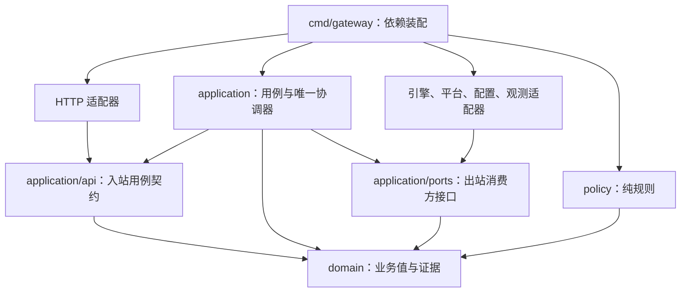

# 架构基线：模块化单体与可替换适配器

修订：2026-11-09。依据用户确认的推荐路线与七项产品取舍，本文件是模块边界的主依据；行为约束仍见 [首版设计](../superpowers/specs/2026-11-08-adaptive-ai-gateway-design.md)。

## 1. 本轮交付边界

本轮目标是形成低耦合、可扩展且有生产演进路径的架构与实施计划，并用最小 Go 基础代码验证依赖方向、资源信号分类和完成证据的范围。当前没有运行中的 HTTP 推理服务、真实引擎适配器或模型实测；后续工作包与完成门槛见 [实施计划](../plans/2026-11-08-implementation-plan.md)。

选择一个 Go 控制进程，以独立原生推理进程作为可替换后端。先保持本机部署、单模型和单执行槽位；未来在接口稳定且有实际需求后拆分远程 Worker。替代方案与取舍见 [ADR-0002](../adr/0002-modular-monolith-and-ports.md)。

## 2. 依赖方向

图描述编译依赖，不表示 HTTP 可以直接调用出站引擎。运行时由组合入口把应用用例注入 HTTP，把出站适配器注入应用；适配器不反向创建协调器。

| 包边界 | 拥有的内容 | 明确不拥有 |
| --- | --- | --- |
| `internal/domain` | 模型与实例身份、资源观测、语义输出、完成证据 | HTTP/SSE、JSON 标签、日志 SDK、系统调用、进程、数据库 |
| `internal/application/api` | 入站适配器可调用的应用用例契约 | 引擎、采样和容量账本操作 |
| `internal/application/ports` | 应用所消费的出站小接口、操作生命周期契约 | 具体引擎名称、OS 常量、供应商请求体 |
| `internal/application` | 用例、调度协调器、容量账本、请求预算、配置代次 | 原始协议解析、进程信号发送、平台探测实现 |
| `internal/policy` | 从显式输入产生资源信号的纯规则 | 队列、锁、进程退出、自动重试、时钟读取 |
| `internal/adapter/http` | 鉴权、DTO、错误码与 SSE 映射、连接背压 | 容量授予、直接启动或杀死引擎 |
| `internal/adapter/llamacpp` | 原生引擎协议、受管进程与完成证据 | HTTP 调用方权限、全局资源账本 |
| `internal/adapter/platform` | 定时采样、原始值归一化 | 决定是否接收请求或中断生成 |
| `internal/adapter/config` | 配置和密钥来源、校验后的值转换 | 修改正在执行的模型实例 |
| `internal/adapter/observability` | 指标、日志与有界诊断记录 | 业务决策持久化与资源所有权 |
| `cmd/gateway` | 创建并连接上述对象，决定启用哪些后端 | 内嵌调度业务规则 |

`internal/core` 不再作为共享杂物包；领域值、消费方接口和协议 DTO 分开。适配器之间没有编译依赖，新平台或新引擎不能通过改 HTTP handler 接入。

入站 `api` 与出站 `ports` 使用两个包。HTTP 的依赖白名单只允许领域值和入站用例契约，不能导入应用实现、引擎端口或其他适配器；当前 `ResourceAssessmentQuery` 已由参考用例实现。后续生成命令与调度诊断同样先定义入站用例，不通过向 handler 暴露后端接口接入。

## 3. 控制流与数据流分开

控制流为“HTTP 命令 → 应用协调器 → 出站工作 → 带实例代次的完成消息”。容量授予、队列顺序、加载需求、预算和释放只由协调器修改。平台采样器和引擎适配器只能报告事实，不直接回收账本条目。

数据流为“引擎语义事件 → 有界输出通道 → HTTP 编码器 → Python 调用方”。语义事件使用 `GenerationEvent`，不把原始 SSE、`http.Response`、进程句柄或供应商 JSON 传入应用核心。慢客户端的背压只能影响自己的有界通道，不能阻塞协调器处理取消、压力与退出证据。

阻塞的加载、生成、退出确认和系统调用在有界出站工作中完成，不在协调器命令循环中执行。所有工作都带 `InstanceRef` / `ExecutionRef`；迟到消息先核对代次，再决定能否改变状态。细节见 [状态、并发与端口契约](runtime-contracts.md)。

## 4. 采集与诊断分开

`ResourceSampler.Sample` 是周期采集端口；`ResourceReader.Read` 是读取已发布快照的端口。HTTP 查询不启动新的系统探测，也不根据查询次数改变采样节奏。`AssessmentService` 是已实现的只读参考用例：读取快照、用显式时钟判断新鲜度、产生资源信号。

这个参考用例不是准入服务。`ResourceGuard` 已实现 normal、warning、critical 与 observation_guard 的分类；连续采样、恢复窗口、排队、容量授予和紧急回收执行由后续协调器完成。CPU 与可选 GPU 信息缺失不会被该内存分类器误当作 critical。

## 5. 扩展方式

| 新需求 | 应新增或替换的位置 | 保持稳定的部分 | 接入前必须证明 |
| --- | --- | --- | --- |
| 新推理后端 | 新出站适配器，组合入口选择实现 | 用例、账本、HTTP 语义事件 | 模型身份、上下文边界、取消与释放证据、未知结果处理 |
| Linux / NVIDIA 等新平台 | 新平台采集器 | 资源观测类型与信号接口 | 单位、采样窗口、缺失状态、内存池是否共享 |
| 新资源策略 | 注入新的纯规则实现 | 资源读取与后端协议 | 不绕过关键观测保护；高自身负载无误判；不持有副作用 |
| 新客户端协议 | 新入站适配器 | 应用命令和完成证据 | 相同取消、预算与部分输出语义 |
| 持久化生命周期 | 到可靠单机阶段引入 journal 端口与适配器 | 现有 HTTP 与引擎协议 | 崩溃重放、重复消息、未知占用与所有权恢复 |
| 远程 Worker | RPC 出站适配器与 Worker 执行端 | 领域身份与证据语义 | Worker 鉴权、命令去重、fencing、分区时不超发资源 |

扩展首先使用显式依赖注入与编译期接口，不在首版引入动态插件加载、反射注册、全局后端单例或通用数据库 Repository。需要新增能力时增加小接口与能力声明，不向所有后端塞入必须实现却无意义的方法。

`BackendCapabilities` 缺省为不支持。附加服务不具有本产品的进程退出权限；若取消后无法证明停止，则维持未知占用而不是假装空闲。仅新增一个接口实现不等于获得了运行能力，必须通过对应契约和实机验证。

硬件适配通过版本化 runtime profile 表达：应用选择已验证的配置引用，后端适配器把它转换为自己的 GPU 层数、线程或设备参数。通用命令只包含模型身份、配置引用和中立的上下文/并发约束，不传任意供应商 JSON 或命令行字符串；配置引用与约束不一致时明确拒绝。参数变化经排空建立新实例，不承诺生成中无缝改变计算放置。

## 6. 就绪与容量分开

`/healthz` 检查控制进程存活。`/readyz` 检查应用是否已初始化、可安全接收并处理 API 命令，关闭或故障时返回未就绪；模型未加载、执行槽位忙、普通排队、临时观测保护或可预期的资源拒绝不单独令服务未就绪。

是否能立即开始生成由 `/admin/scheduler` 的 `can_execute_now`、`can_queue`、模型状态与保护原因表达。资源保护仍在实际生成准入时执行，不能因 readyz 返回 200 而绕过。

这个修订避免“未加载 → 未就绪 → 收不到首次调用 → 永远无法按需加载”。Kubernetes 对失败 readiness 会撤下 Service 端点，见 [官方说明](https://kubernetes.io/docs/concepts/workloads/pods/probes/#readiness-probe)；本项目的拆分是针对按需推理的工程选择，详见 [ADR-0004](../adr/0004-service-readiness-and-capacity.md)。

## 7. 约束如何验证

[依赖清单](../../architecture/dependencies.json) 是可执行边界，`go run ./cmd/archcheck` 扫描所有生产 Go 源文件，包括当前主机不编译的平台变体。领域层不能引入网络或进程 API，应用不能依赖具体适配器，纯规则的导入限于领域值和时间类型；未登记生产模块、未批准外部依赖与实际循环均失败。固定时间的行为测试另外约束规则使用显式时间，而不是把导入检查当作完整的副作用证明。

检查器自身有越界、循环和非本机平台文件的反例测试；额外以实际依赖清单验证 HTTP 不可导入出站端口、应用实现或引擎适配器。应用测试用两个独立资源读取实现验证替换无需改用例，策略测试覆盖缺失/过期/未来时间和高自身 CPU，证据测试拒绝旧实例和旧执行结果。检查器不验证反射、标准库调用等全部运行行为或真实 GPU 释放，因此不能代替代码审查及后续引擎契约测试。

运行入口为 `make check`。架构、普通测试、race 和 vet 各自保留结果；机器可读 API 与 fixture 验证另见 `make contracts`。生产演进与各阶段准入条件见 [生产化路线](production-evolution.md)。
